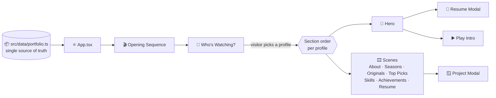

<div align="center">

<a href="https://deepak05-portfolio.netlify.app/">
  
</a>
<br />
<br />
<a href="https://deepak05-portfolio.netlify.app/">
  
</a>
<br />
<br />
[](https://deepak05-portfolio.netlify.app/)
[](public/assets/Deep.pdf)
[](https://www.linkedin.com/in/deepak-b-v/)
[](mailto:deepake4d@gmail.com)
 


 
</div>
---
 
<div align="center">
**[🍿 Premise](#-the-premise)** ·
**[👥 Profiles](#-whos-watching)** ·
**[✨ Features](#-features)** ·
**[🎞️ Originals](#️-the-originals-featured-work)** ·
**[🏗️ Architecture](#️-architecture)** ·
**[🚀 Run it](#-run-it-locally)** ·
**[👨‍💻 About](#-about-me)** ·
**[📬 Contact](#-lets-connect)**
 
</div>
---
 
## 🍿 The Premise
 
Most portfolios are a scroll of cards. This one is a **series**.
 
A visitor lands on a **cinematic opening sequence**, gets asked **"Who's watching?"**, and the whole site rearranges itself around them. Projects are **Originals**. The experience timeline is **Seasons**. The resume is **The Story**. Hover a poster, open an episode, hit play on the trailer.
 
The goal is simple: be remembered, and let a recruiter, a developer or a client find exactly what they came for in seconds.
 
<div align="center">
### 🔴 [deepak05-portfolio.netlify.app](https://deepak05-portfolio.netlify.app/)
*Best experienced on desktop with sound of your own choosing.* 😉
 
</div>
---
 
## 📊 By the Numbers
 
<div align="center">
| 🎭 | 🧩 | 🗂️ | 🎬 | ⌨️ | 📦 |
| :-: | :-: | :-: | :-: | :-: | :-: |
| **4** | **23** | **7** | **5** | **3,300+** | **1** |
| viewer profiles | React components | story sections | featured projects | lines of TS / TSX | typed data file drives it all |
 
</div>
---
 
## 👥 Who's Watching?
 
The same content, four different cuts. Each profile **reorders the sections** so every visitor sees what matters to them first.
 
| Profile | Built for | Opens with |
| :-- | :-- | :-- |
| 🔴 **Deepak** | The full, in-order experience | About → Journey → Originals → Top Picks → Skills → Moments → Story |
| 💼 **Recruiter** | Hiring managers on a tight clock | **Resume story** → Achievements → Skills → Originals |
| 💻 **Developer** | Engineers who want to see the work | **Originals (projects)** → Skills → Journey → Achievements |
| ✨ **Creative** | People curious about the design side | **Journey** → Top Picks → Originals → Achievements |
 
Switch profiles any time from the navbar. Press `Esc` on the selector to jump straight into the default cut.
 
---
 
## ✨ Features
 
<table>
<tr>
<td width="50%" valign="top">
### 🎬 Cinematic experience
- Opening sequence and a lazy-loaded **Play Intro** trailer
- **Profile-based navigation** that reorders content per visitor
- Streaming-UI patterns: *Continue Watching*, *Top Picks*, rails, posters, episode cards
- **Custom cursor** and **Lenis smooth scrolling**
- Scroll-driven section progress and Framer Motion transitions
</td>
<td width="50%" valign="top">
### 🛠️ Built like a product
- **Project modals** with logline, stack, build notes, features and source links
- **In-site resume viewer**, no new tab needed
- **Responsive WebP portraits** via `srcset`
- **SEO-ready**: Open Graph and Twitter Card metadata
- **Single typed data file** powers the whole site
</td>
</tr>
</table>
---
 
## 🎞️ The Originals (Featured Work)
 
| Project | What it does | Stack | Source |
| :-- | :-- | :-- | :-: |
| 🧭 **CareerForge AI** *(2026)* | AI career assistant: skill-gap analysis, career matching, resume building and personalized learning | Next.js · React · TypeScript · NestJS · Prisma · PostgreSQL · FastAPI | [Repo](https://github.com/Deepak-tech06/careerforge-ai) |
| 🎓 **Cynaris Internship Platform** *(2026)* | Internship management with admin and student workflows, invite-based registration, assignments and **real-time notifications** | React · Node.js · Express · PostgreSQL · Socket.IO · JWT | [Repo](https://github.com/Deepak-tech06/cynaris-internship-platform) |
| 🪡 **Sewing Machine Services** *(2026)* | Service website with listings, direct call / WhatsApp contact and an interactive service-location map | React · TypeScript · Vite · Tailwind · TanStack Router | [Repo](https://github.com/Deepak-tech06/reliable-sewing-machine-service) |
| 🏢 **Cynaris AI Enterprise Website** *(2025)* | Responsive multi-page website for an AI, data and cloud solutions company, live on Vercel | HTML · CSS · JavaScript | [Repo](https://github.com/Deepak-tech06/cynaris-ai) |
| 📊 **Power BI Sales Analysis** *(2025)* | Turned cleaned sales and customer data into interactive dashboards | Power BI · Data Cleaning · Visualization | — |
 
---
 
## 🏗️ Architecture
 

 
<details>
<summary><b>⚙️ Engineering details worth noting</b> (click to expand)</summary>
<br />
- **One typed data file.** Profile, education, experience, projects, skills, certifications and viewer profiles live in `src/data/portfolio.ts`. Edit it and the whole site updates.
- **Code splitting.** The heavy overlays (`PlayIntro`, `ProjectModal`, `ResumeModal`) load with `React.lazy` and `Suspense`, and `react` and `framer-motion` get their own chunks via Rollup `manualChunks`.
- **Optimized portraits.** `npm run images` runs a Sharp script that merges a high-resolution photo with a background-removed cutout's alpha mask, then writes 420 / 720 / 1100 px WebP files for responsive `srcset` delivery. The hero portrait is also preloaded in `index.html`.
- **No dead links.** A project's GitHub button is hidden when no public repo is set, so visitors never hit a 404.
- **Accessible dialogs.** The profile selector is a labeled dialog with keyboard support.
- **Strict builds.** `npm run build` type-checks with `tsc -b` before bundling, so type errors never ship.
- **SPA-safe hosting.** `netlify.toml` sets the build command, publish directory and a catch-all redirect to `index.html`.
</details>
<details>
<summary><b>📁 Project structure</b> (click to expand)</summary>
<br />
```text
deepak-portfolio/
├── public/
│   ├── assets/                 # Optimized portraits, OG image, resume PDF
│   └── favicon.svg
├── scripts/
│   └── build-images.mjs        # Sharp image pipeline
├── src/
│   ├── components/             # 23 components: Hero, Originals, Skills, modals, cursor...
│   ├── data/
│   │   └── portfolio.ts        # All site content, fully typed
│   ├── hooks/                  # Smooth scroll, media query, section progress
│   ├── App.tsx                 # Stage flow: opening → profiles → series
│   ├── index.css
│   └── main.tsx
├── index.html                  # Fonts, theme color, OG / Twitter metadata
├── netlify.toml                # Build config and SPA redirect
├── vite.config.ts
└── package.json
```
 
</details>
---
 
## 🧰 Tech Stack
 
<div align="center">

</div>
<br />
| Layer | Technology |
| :-- | :-- |
| **UI** | React 18.3 |
| **Language** | TypeScript 5.8 |
| **Build tool** | Vite 6 |
| **Styling** | Tailwind CSS 4 (via `@tailwindcss/vite`) |
| **Animation** | Framer Motion 11 |
| **Smooth scroll** | Lenis |
| **Image pipeline** | Sharp |
| **Typography** | Bebas Neue · Instrument Serif · Inter |
| **Hosting** | Netlify |
 
---
 
## 🚀 Run It Locally
 
**Prerequisites:** Node.js (current LTS) and npm.
 
```bash
git clone https://github.com/Deepak-tech06/deepak-portfolio.git
cd deepak-portfolio
npm install
npm run dev
```
 
Open the URL Vite prints (usually `http://localhost:5173`).
 
| Command | What it does |
| :-- | :-- |
| `npm run dev` | Start the Vite dev server |
| `npm run build` | Type-check with `tsc -b`, then build to `dist/` |
| `npm run preview` | Preview the production build locally |
| `npm run images` | Rebuild optimized portrait WebP files from the source photos |
 
### 🎨 Make it yours
 
1. Edit `src/data/portfolio.ts` with your profile, education, experience, projects, skills and links.
2. Swap the images and resume in `public/assets/` and update `og-image.jpg` for link previews.
3. Adjust the viewer profiles in the same file to reorder sections for each audience.
4. Push to GitHub and import into Netlify. The included `netlify.toml` handles the rest.
---
 
## 👨‍💻 About Me
 
<table>
<tr>
<td width="62%" valign="top">
I'm **Deepak B V**, a BCA graduate (RNS First Grade College, 2023–2026) from **Bengaluru, India**. I build responsive web apps with React, TypeScript, Node.js and PostgreSQL, and connect them to REST APIs and Python-based AI services.
 
**🏢 Experience**
Full-Stack Developer Intern at **Cynaris Solutions Pvt. Ltd.** (Nov–Dec 2025):
- Built **four React frontend pages** for an internship management platform
- Implemented **authentication, invitation workflows and admin features** with Node.js and Express
- Worked with **six Sequelize database models** on a React + Express + PostgreSQL (Supabase) stack
- Collaborated through Git and GitHub
**🎨 Beyond code**
I designed branding for the **AAROHI Fest**: posters, brochures, certificates, tickets and sponsor backdrops.
 
</td>
<td width="38%" valign="top">
**🧠 Currently**
- 🔭 Building **CareerForge AI**
- 🌱 Going deeper into AI integration and Generative AI
- 📊 Exploring data analytics with Power BI
- 💬 Open to internships, full-time roles and collaborations
**🏅 Certifications**
- Google Analytics, Great Learning (2023)
- Intro to Cybersecurity, Cisco (2025)
- Python Fundamentals, Infosys Springboard (2025)
- Microsoft Power BI, Infosys Springboard (2025)
</td>
</tr>
</table>
| | |
| :-- | :-- |
| **Languages** | Python · JavaScript · TypeScript · Java · C · C++ |
| **Frontend** | React · Next.js · HTML · CSS · Tailwind CSS · MUI |
| **Backend** | Node.js · Express.js · NestJS · FastAPI · PHP |
| **Databases** | PostgreSQL · MySQL · MongoDB · Supabase · Prisma |
| **AI & Data** | Generative AI · ML fundamentals · Power BI · Google Analytics |
| **Tools** | Git · GitHub · Docker · Postman · Vercel · Render · n8n |
| **Design** | Canva · CapCut · Brand identity · Poster and promotional design |
 
---
 
## 📬 Let's Connect
 
I'm open to **internships, full-time roles and collaborations** around web development and AI-powered products. If something here caught your eye, say hello.
 
<div align="center">
| | |
| :-- | :-- |
| 🌐 **Portfolio** | [deepak05-portfolio.netlify.app](https://deepak05-portfolio.netlify.app/) |
| 💼 **LinkedIn** | [linkedin.com/in/deepak-b-v](https://www.linkedin.com/in/deepak-b-v/) |
| 🐙 **GitHub** | [@Deepak-tech06](https://github.com/Deepak-tech06) |
| ✉️ **Email** | [deepake4d@gmail.com](mailto:deepake4d@gmail.com) |
| 📍 **Location** | Bengaluru, India |
 
</div>
---
 
<div align="center">
### Thanks for watching. 🎬
 
**If this portfolio impressed you, a ⭐ on the repo means a lot.**
 

<sub>Designed and built by <a href="https://github.com/Deepak-tech06">Deepak B V</a></sub>
 
</div>
 
