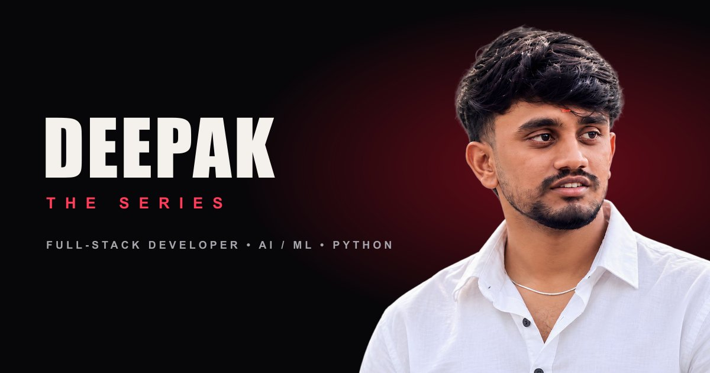
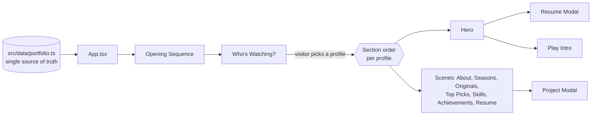

<div align="center">



<br />

### A portfolio that plays like a streaming platform.
**Every project is an episode. Every skill is part of the journey.**

<br />

[](https://deepak05-portfolio.netlify.app/)
[](public/assets/Deep.pdf)
[](https://www.linkedin.com/in/deepak-b-v/)
[](mailto:deepake4d@gmail.com)


</div>

---

<div align="center">

[Premise](#premise) · [Profiles](#profiles) · [Features](#features) · [Originals](#originals) · [Architecture](#architecture) · [Run locally](#run-locally) · [About](#about) · [Contact](#contact)

</div>

---

<a id="premise"></a>

## 🍿 The Premise

Most portfolios are a scroll of cards. This one is a **series**.

A visitor lands on a **cinematic opening sequence**, gets asked **"Who's watching?"**, and the whole site rearranges itself around them. Projects are **Originals**, the experience timeline is **Seasons**, and the resume is **The Story**.

The goal is simple: be remembered, and let a recruiter, a developer or a client find exactly what they came for in seconds.

> 🔴 **Live site:** [deepak05-portfolio.netlify.app](https://deepak05-portfolio.netlify.app/)

### By the numbers

| 4 | 23 | 7 | 5 |
| :-: | :-: | :-: | :-: |
| **viewer profiles** | **React components** | **story sections** | **featured projects** |

---

<a id="profiles"></a>

## 👥 Who's Watching?

The same content, four different cuts. Each profile **reorders the sections** so every visitor sees what matters to them first.

| Profile | Built for | Opens with |
| :-- | :-- | :-- |
| 🔴 **Deepak** | The full, in-order experience | About → Journey → Originals → Top Picks → Skills → Moments → Story |
| 💼 **Recruiter** | Hiring managers on a tight clock | Resume story → Achievements → Skills → Originals |
| 💻 **Developer** | Engineers who want to see the work | Originals (projects) → Skills → Journey → Achievements |
| ✨ **Creative** | People curious about the design side | Journey → Top Picks → Originals → Achievements |

You can switch profiles at any time from the navbar. Press `Esc` on the selector to jump straight into the default cut.

---

<a id="features"></a>

## ✨ Features

**🎬 Cinematic experience**
- Opening sequence and a lazy-loaded **Play Intro** trailer
- **Profile-based navigation** that reorders content per visitor
- Streaming-UI patterns: *Continue Watching*, *Top Picks*, rails, posters and episode cards
- **Custom cursor** and **Lenis smooth scrolling**
- Scroll-driven section progress and Framer Motion transitions

**🛠️ Built like a product**
- **Project modals** with logline, stack, build notes, features and source links
- **In-site resume viewer**, no new tab needed
- **Responsive WebP portraits** using `srcset`
- **SEO-ready** with Open Graph and Twitter Card metadata
- **One typed data file** that powers the whole site

---

<a id="originals"></a>

## 🎞️ The Originals (Featured Work)

| Project | What it does | Stack | Source |
| :-- | :-- | :-- | :-: |
| 🧭 **CareerForge AI** | AI career assistant: skill-gap analysis, career matching, resume building and personalized learning | Next.js · React · TypeScript · NestJS · Prisma · PostgreSQL · FastAPI | [Repo](https://github.com/Deepak-tech06/careerforge-ai) |
| 🎓 **Cynaris Internship Platform** | Internship management with admin and student workflows, invite-based registration, assignments and real-time notifications | React · Node.js · Express · PostgreSQL · Socket.IO · JWT | [Repo](https://github.com/Deepak-tech06/cynaris-internship-platform) |
| 🪡 **Sewing Machine Services** | Service website with listings, call / WhatsApp contact and a service-location map | React · TypeScript · Vite · Tailwind · TanStack Router | [Repo](https://github.com/Deepak-tech06/reliable-sewing-machine-service) |
| 🏢 **Cynaris AI Enterprise Website** | Responsive multi-page website for an AI, data and cloud solutions company | HTML · CSS · JavaScript | [Repo](https://github.com/Deepak-tech06/cynaris-ai) |
| 📊 **Power BI Sales Analysis** | Cleaned and modeled sales and customer data into interactive dashboards | Power BI · Data Cleaning · Visualization | — |

---

<a id="architecture"></a>

## 🏗️ Architecture



### Engineering details

- **One typed data file.** Profile, education, experience, projects, skills, certifications and viewer profiles live in `src/data/portfolio.ts`. Edit it and the whole site updates.
- **Code splitting.** The heavy overlays (`PlayIntro`, `ProjectModal`, `ResumeModal`) load with `React.lazy` and `Suspense`, and `react` and `framer-motion` get their own chunks through Rollup `manualChunks`.
- **Optimized portraits.** `npm run images` runs a Sharp script that merges a high-resolution photo with a background-removed cutout's alpha mask, then writes 420 / 720 / 1100 px WebP files for responsive `srcset` delivery.
- **No dead links.** A project's GitHub button is hidden when no public repo is set, so visitors never hit a 404.
- **Strict builds.** `npm run build` type-checks with `tsc -b` before bundling.
- **SPA-safe hosting.** `netlify.toml` sets the build command, publish directory and a catch-all redirect to `index.html`.

### Project structure

```text
deepak-portfolio/
├── public/
│   ├── assets/                 # Portraits, OG image, banner, resume PDF
│   └── favicon.svg
├── scripts/
│   └── build-images.mjs        # Sharp image pipeline
├── src/
│   ├── components/             # 23 components: Hero, Originals, Skills, modals...
│   ├── data/
│   │   └── portfolio.ts        # All site content, fully typed
│   ├── hooks/                  # Smooth scroll, media query, section progress
│   ├── App.tsx                 # Stage flow: opening, profiles, series
│   ├── index.css
│   └── main.tsx
├── index.html                  # Fonts, theme color, OG / Twitter metadata
├── netlify.toml                # Build config and SPA redirect
├── vite.config.ts
└── package.json
```

### Tech stack

| Layer | Technology |
| :-- | :-- |
| **UI** | React 18.3 |
| **Language** | TypeScript 5.8 |
| **Build tool** | Vite 6 |
| **Styling** | Tailwind CSS 4 (via `@tailwindcss/vite`) |
| **Animation** | Framer Motion 11 |
| **Smooth scroll** | Lenis |
| **Image pipeline** | Sharp |
| **Typography** | Bebas Neue · Instrument Serif · Inter |
| **Hosting** | Netlify |

---

<a id="run-locally"></a>

## 🚀 Run It Locally

**Prerequisites:** Node.js (current LTS) and npm.

```bash
git clone https://github.com/Deepak-tech06/deepak-portfolio.git
cd deepak-portfolio
npm install
npm run dev
```

Open the URL Vite prints (usually `http://localhost:5173`).

| Command | What it does |
| :-- | :-- |
| `npm run dev` | Start the Vite dev server |
| `npm run build` | Type-check with `tsc -b`, then build to `dist/` |
| `npm run preview` | Preview the production build locally |
| `npm run images` | Rebuild optimized portrait WebP files from the source photos |

**Make it yours:** edit `src/data/portfolio.ts` with your own details, swap the images and resume in `public/assets/`, then push to GitHub and import the repo into Netlify. The included `netlify.toml` handles the rest.

---

<a id="about"></a>

## 👨‍💻 About Me

I'm **Deepak B V**, a BCA graduate (RNS First Grade College, 2023–2026) from **Bengaluru, India**. I build responsive web apps with React, TypeScript, Node.js and PostgreSQL, and connect them to REST APIs and Python-based AI services.

### Experience

**Full-Stack Developer Intern, Cynaris Solutions Pvt. Ltd.** (Nov–Dec 2025)
- Built **four React frontend pages** for an internship management platform
- Implemented **authentication, invitation workflows and admin features** with Node.js and Express
- Worked with **six Sequelize database models** on a React + Express + PostgreSQL (Supabase) stack
- Collaborated through Git and GitHub

### Skills

| | |
| :-- | :-- |
| **Languages** | Python · JavaScript · TypeScript · Java · C · C++ |
| **Frontend** | React · Next.js · HTML · CSS · Tailwind CSS · MUI |
| **Backend** | Node.js · Express.js · NestJS · FastAPI · PHP |
| **Databases** | PostgreSQL · MySQL · MongoDB · Supabase · Prisma |
| **AI & Data** | Generative AI · ML fundamentals · Power BI · Google Analytics |
| **Tools** | Git · GitHub · Docker · Postman · Vercel · Render · n8n |
| **Design** | Canva · CapCut · Brand identity · Poster and promotional design |

### Certifications

- Google Analytics, Great Learning (2023)
- Introduction to Cybersecurity, Cisco (2025)
- Python Fundamentals, Infosys Springboard (2025)
- Microsoft Power BI, Infosys Springboard (2025)

### Beyond code

I designed the branding for the **AAROHI Fest**: posters, brochures, certificates, tickets and sponsor backdrops.

---

<a id="contact"></a>

## 📬 Let's Connect

I'm open to **internships, full-time roles and collaborations** around web development and AI-powered products.

| | |
| :-- | :-- |
| 🌐 **Portfolio** | [deepak05-portfolio.netlify.app](https://deepak05-portfolio.netlify.app/) |
| 💼 **LinkedIn** | [linkedin.com/in/deepak-b-v](https://www.linkedin.com/in/deepak-b-v/) |
| 🐙 **GitHub** | [@Deepak-tech06](https://github.com/Deepak-tech06) |
| ✉️ **Email** | [deepake4d@gmail.com](mailto:deepake4d@gmail.com) |
| 📍 **Location** | Bengaluru, India |

---

<div align="center">

### Thanks for watching. 🎬

If this portfolio impressed you, a ⭐ on the repo means a lot.

<sub>Designed and built by <a href="https://github.com/Deepak-tech06">Deepak B V</a></sub>

</div>
